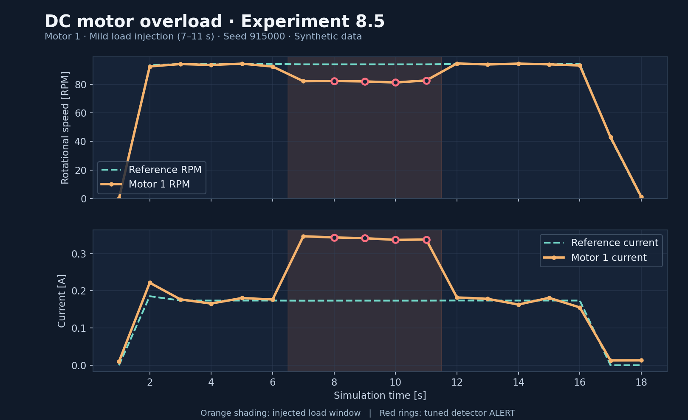

# Motor Telemetry Simulator


[](LICENSE)

**A physics-based DC motor simulator for testing overload detection with synthetic telemetry.**

I started this project to understand what happens to motor current and speed when a robot runs into extra mechanical load. Instead of assigning RPM directly from PWM, I wanted the motor behavior to come from electrical and mechanical equations.

Right now, the program simulates **two DC motors** and compares two overload detectors under the same conditions. The next step is to turn this single-file experiment into reusable modules and eventually compare it against real motor measurements.

## A look at the simulation



*Experiment 8.5, mild overload on motor 1 (seed `915000`). The shaded interval is an injected fault, not a hardware measurement. Red circles indicate confirmed alerts from detector B.*

In this run, the reference motor stays near **94 RPM / 0.17 A** while the loaded motor drops to roughly **82 RPM** and draws about **0.34 A**. The original detector misses the mild overload; the tuned one detects it.

## What it simulates

- DC motor current, back-EMF, torque, angular velocity, and friction.
- Two motors powered by a shared battery model, including voltage sag.
- Parameter variations, noisy RPM/current measurements, and injected loads.
- A nominal reference motor for comparing expected and observed behavior.
- Independent tuning and validation datasets for comparing detector settings.

**Model:** forward Euler integration, `dt = 0.002 s`. Electrical and mechanical parameters are *estimates*, not measured motor constants.

## What I found

Experiment 8.5 uses separate random seeds for detector tuning and validation. Both detectors are evaluated on identical simulated telemetry.

| Detector | Detected motor-events | Missed | Alerts outside the injected fault window |
|---|---:|---:|---:|
| A — Baseline | 60 / 70 (85.7%) | 10 | 0 |
| B — Tuned | 70 / 70 (100%) | 0 | 0 |

The main improvement was detecting **mild overloads** that the baseline configuration missed. Detector B checks for both a speed drop and a current increase over two consecutive telemetry samples.

**Important:** 100% here means *70 out of 70 events in this synthetic validation set*. It does **not** mean 100% accuracy on real motors. Sensor faults, different loads, driver behavior, battery characteristics, and untested conditions may change the results.

## How it works

```text
        PWM + motor parameters + mechanical loads
                          |
                          v
             DC motor + battery simulation
                          |
                   RPM / A / V samples
                          |
               +----------+----------+
               |                     |
               v                     v
        Reference motor       Observed motor
               |                     |
               +----------+----------+
                          |
             RPM and current deviations
                          |
                  Detector A / B
                          |
              Warnings and fault alerts
```

The motor simulation, detector comparison, and CSV export are currently in one file. Modularization is in progress; I am keeping the original experiment as a regression reference.

## Run it

Requires **Python 3**, using only the standard library.

```bash
python experiment_08_5_detector_comparison.py
```

The script runs the tuning and validation scenarios, prints the A/B results, and asks whether to export CSV files. Enter `0` to skip export.

## What comes next

- Split the motor model, telemetry generator, and detector into separate Python modules.
- Add automated regression tests so refactoring cannot silently change results.
- Document parameter selection and numerical limitations.
- Record real current, RPM, and bus voltage from a DC motor setup, then calibrate and re-evaluate the model.

## License

[MIT](LICENSE).
